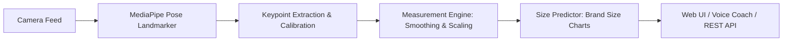

# 📏 AI Shirt Size Detector — Smart Fit Studio

An intelligent, real-time computer vision system that measures human upper-body dimensions (shoulder width and chest breadth) using pose landmark estimation and automatically recommends the best shirt size across various brands and fits.

[](https://www.python.org/)
[](https://fastapi.tiangolo.com/)
[](https://developers.google.com/mediapipe)
[](https://opencv.org/)
[](LICENSE)

---

## ✨ Features

- **🎯 Contactless Body Measurement**: Extracts anthropometric keypoints in real time to calculate shoulder width and chest width in centimeters.
- **🧠 MediaPipe Pose Landmarker (Heavy)**: Leverages state-of-the-art deep learning pose landmarks for sub-pixel landmark precision.
- **📊 Brand & Fit Matching**: Seamlessly maps physical measurements against customizable brand sizing charts (Generic, custom retail brands, Slim Fit, Regular Fit, etc.).
- **🎙️ Voice AI Fitting Coach**: Built-in interactive audio guidance that instructs the user to step back, adjust distance, stand straight, and confirms when sizing is complete.
- **🖥️ Dual Mode Execution**:
  - **Modern Web Studio**: Responsive dark-mode interface with live canvas rendering, visual posture guides, and real-time metric cards.
  - **Desktop OpenCV Application**: Direct camera stream with HUD telemetry, landmark overlay, and instant terminal feedback.
- **📈 Temporal Smoothing**: Incorporates moving-average queues to filter out frame jitter and camera noise for rock-solid stability.

---

## 🏗️ System Architecture



---

## 📁 Project Structure

```text
AI-Shirt-Size-Detector/
├── frontend/
│   ├── index.html                  # Web Studio UI & Canvas Tracking
│   ├── styles.css                  # Modern Glassmorphic styling
│   └── pose_landmarker_heavy.task  # MediaPipe Vision model (client-side)
├── api.py                          # FastAPI backend application
├── main.py                         # Standalone OpenCV desktop application
├── measurement_engine.py           # Core pose calculation & calibration engine
├── size_predictor.py               # Size chart matching & recommendation logic
├── size_charts.json                # Brand and fit dimension limits
├── pose_landmarker_heavy.task      # MediaPipe model for Python backend
├── requirements.txt                # Python dependencies
└── README.md                       # Project documentation
```

---

## 🚀 Quick Start

### 1. Clone the Repository

```bash
git clone https://github.com/MadhanBV/AI-Shirt-Size-Detector.git
cd AI-Shirt-Size-Detector
```

### 2. Set Up Virtual Environment

```bash
# Windows
python -m venv .venv
.\.venv\Scripts\activate

# macOS / Linux
python3 -m venv .venv
source .venv/bin/activate
```

### 3. Install Dependencies

```bash
pip install -r requirements.txt
```

---

## 💻 Running the Application

### Option A: Web Application (Recommended)

Start the FastAPI server:

```bash
uvicorn api:app --reload --host 0.0.0.0 --port 8000
```

Open your browser and navigate to:
```
http://localhost:8000
```
*(Redirects to `/frontend/index.html`)*

### Option B: Desktop OpenCV Mode

Run the native OpenCV camera window:

```bash
python main.py
```

*Press `q` to quit the desktop camera feed.*

---

## 📡 API Endpoints

| Method | Endpoint | Description |
| :--- | :--- | :--- |
| `GET` | `/` | Redirects to Web Studio frontend |
| `GET` | `/health` | Server health check |
| `POST` | `/analyze-frame` | Upload an image frame to process pose landmarks and return sizing |
| `GET` | `/api/brands` | List all supported apparel brands |
| `GET` | `/api/fits` | List fit variations (regular, slim, etc.) for a brand |
| `POST` | `/api/recommend-size` | Submit manual measurements to get size recommendations |

---

## 📐 Calibration & Measurement Details

1. **User Height Calibration**: The engine calculates `cm_per_pixel` using known height references or standardized body-span ratios.
2. **Shoulder Breadth**: Measured between Left Shoulder (Landmark 11) and Right Shoulder (Landmark 12), with lateral acromion compensation.
3. **Chest Breadth**: Extrapolated using anatomical torso proportions below the shoulder line.
4. **Distance Guidance**: Best results are obtained by standing **6 to 8 feet** away from the camera in good lighting.

---

## 🛠️ Tech Stack

- **Computer Vision**: [MediaPipe](https://developers.google.com/mediapipe), [OpenCV](https://opencv.org/)
- **Backend**: [FastAPI](https://fastapi.tiangolo.com/), [Uvicorn](https://www.uvicorn.org/), [Pydantic](https://docs.pydantic.dev/)
- **Frontend**: Vanilla HTML5, CSS3, Modern JavaScript, Canvas API, Web Speech API
- **Language**: Python 3.10+

---

## 🤝 Contributing

Contributions are always welcome!
1. Fork the Project (`git checkout -b feature/AmazingFeature`)
2. Commit your Changes (`git commit -m 'Add some AmazingFeature'`)
3. Push to the Branch (`git push origin feature/AmazingFeature`)
4. Open a Pull Request

---

## 📄 License

Distributed under the MIT License. See `LICENSE` for more information.
